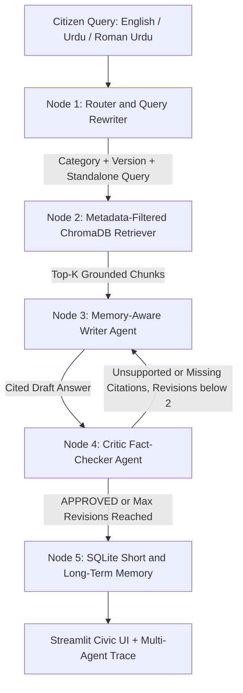

# 🇵🇰 PakSahulat AI (Sarkari Kaam Asaan)

**PakSahulat AI** is a bilingual, multi-agent Retrieval-Augmented Generation (RAG) citizen assistant built to simplify Pakistani public service procedures across **NADRA**, **HEC**, and **PECA (2016 & 2025)**. Powered by **LangGraph**, **ChromaDB**, **Google Gemini**, **SQLite**, and **Streamlit**, it delivers grounded, citation-backed answers in **English**, **Urdu script (`اردو`)**, and **Roman Urdu** while preventing hallucinations through a self-correcting **Writer–Critic** reflection loop.

---

## 🏗️ Multi-Agent Architecture



---

## 📊 Automated Evaluation Results (`data/eval_report.json`)

Evaluated across 5 end-to-end test scenarios covering temporal comparison (`PECA 2016 vs. 2025`), `NADRA`, `HEC`, bilingual `Roman Urdu`, and `Out-of-Scope` hallucination prevention:

| Test Case | Routing Accuracy | Retrieval Accuracy | Faithfulness | Answer Relevancy | Citations Included |
| :--- | :---: | :---: | :---: | :---: | :---: |
| **TC-01 (PECA Comparison)** | PASS | PASS | 5/5 | 5/5 | YES |
| **TC-02 (NADRA FRC)** | PASS | PASS | 5/5 | 5/5 | YES |
| **TC-03 (HEC Attestation)** | PASS | PASS | 5/5 | 5/5 | YES |
| **TC-04 (Bilingual Roman Urdu)** | PASS | PASS | 5/5 | 5/5 | YES |
| **TC-05 (Out-of-Scope Guardrail)** | PASS | PASS | N/A *(Refusal)* | N/A *(Refusal)* | YES |

### Key Engineering Highlights

* **100% Routing & Retrieval Precision (5/5)**: Combined `$and` metadata filtering (`category` + `version`) ensures every query hits the exact department and legal version.
* **5/5 In-Scope Faithfulness & Grounded Citations**: Every in-scope response achieved maximum faithfulness and relevancy backed by `[Document Title, p.X]` citations and Critic verification.
* **Resilient Multi-Model Fallback Chain**: Automatically fails over across multiple Gemini Flash / Flash-Lite quota pools (`with_fallbacks`) to prevent live rate-limit interruptions.
* **Strict Out-of-Scope Guardrails**: Queries outside NADRA, HEC, and PECA are intercepted by the Router and politely declined in the user's exact script without hallucination.

---

## 🚀 Setup & Run

**1. Clone the project**
```bash
git clone https://github.com/shahibadshah987-star/PakSahulat-AI.git
cd PakSahulat-AI
```

**2. Create and activate a virtual environment**
```bash
python -m venv .venv
.venv\Scripts\activate        # Windows
source .venv/bin/activate     # macOS / Linux
```

**3. Install dependencies**
```bash
pip install -r requirements.txt
```

**4. Add your Gemini API key**

Create a file named `.env` in the project's main folder with this one line, replacing the placeholder with your own key from [Google AI Studio](https://aistudio.google.com/apikey):
```
GEMINI_API_KEY=your_key_here
```

**5. Build the vector database** (run from the project's main folder)
```bash
python src/build_vector_db.py
```
This reads the policy documents in `data/raw/` and creates the `chroma_db/` folder. Running it again rebuilds the database from scratch.

**6. Launch the app**
```bash
streamlit run app.py
```

---

## 🔮 Future Work

* **FIA complaint guidance** as its own category, with dedicated source documents, Router support and evaluation tests.
